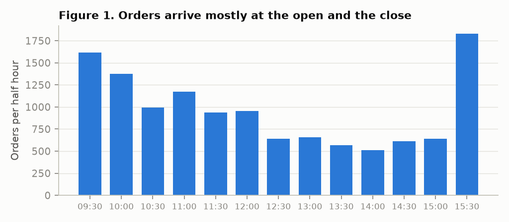
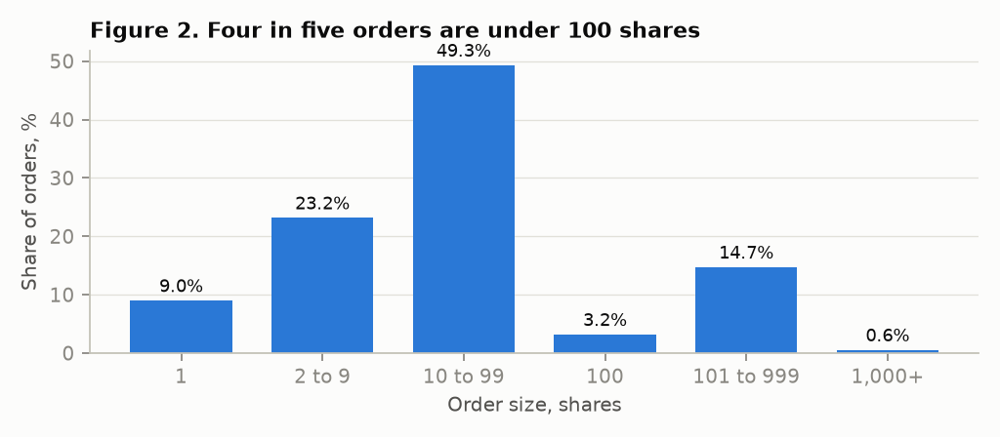
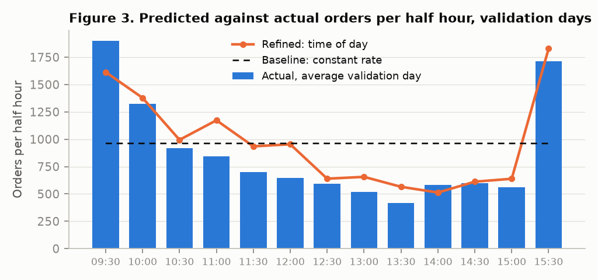
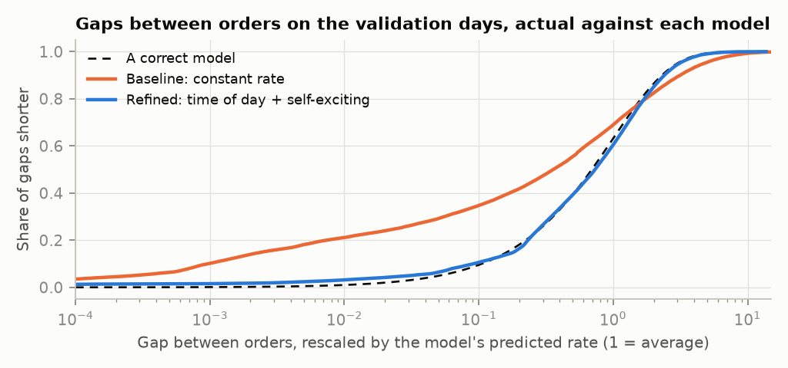
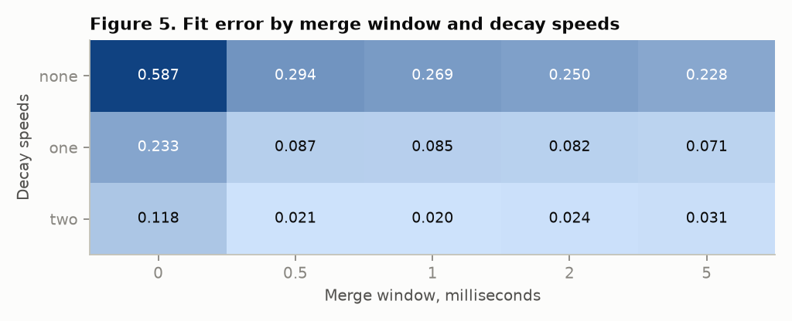

# Modelling Order Flow in GLD: When Trades Arrive, How Big They Are and Which Way They Go

FINS3666 Group Project, Appendix B: Client Order Flow Analysis

## 1. Introduction and Research Objective

A market maker earns the spread only when someone trades against its quotes. Its profit and its risk therefore depend on three things about incoming trades: how often they arrive, how large they are and whether buys and sells balance. Arrival rate sets how often quotes are hit. Size sets how far inventory jumps on each hit. Balance sets whether inventory drifts one way.

Our objective is to build and validate a model of those three things for GLD, the SPDR Gold Shares ETF, on NYSE Arca. We test three claims:

1. Orders arrive in bursts, so a model where each order briefly raises the chance of another fits better than a constant rate.
2. Order sizes cluster at round numbers, so a smooth curve alone misprices them.
3. Order direction carries memory, so the last order helps predict the next.

We chose this topic from the data. Before settling on it we tested 86 trading strategy setups on GLD and the GC gold future and found no edge after costs (Table 1). GLD is too efficient for the strategies our data can simulate. The same data showed strong, stable structure in how trades arrive, which is the input a market maker needs.

**Table 1. Strategies tested and dropped (1 May to 31 July 2026)**

| Strategy | Evidence |
|---|---|
| Trade the gap between GLD and its GC-implied value | Gap is 0.3 to 0.6 bps wide against a 0.82 bps spread |
| Follow GC into GLD | Correlation is 0.94 in the same second and 0.035 one second later |
| Intraday momentum, one trade a day | +1.2 bps a trade, t-statistic 0.48, carried by one day |
| Scale a GLD position by forecast volatility | Risk unchanged at matched exposure (ratio 1.00) |

Key assumptions: trades on one exchange stand in for the flow a market maker on that exchange faces, same-side fills within one millisecond belong to one order, and each trading day follows the same process.

## 2. Data Description and Background Analysis

We use every trade in GLD on NYSE Arca for ten sessions, 4 to 15 May 2026, from the exchange's top-of-book feed. Each trade carries a nanosecond timestamp, price, size, the best bid and ask, and the side that initiated it. We fit on 4 to 8 May and hold out 11 to 15 May. A second file, one quote snapshot a second from May to October 2026, lets us check trading activity over six months.

**Table 2. Dataset after cleaning**

| Item | Fit week | Validation week |
|---|---|---|
| Trading days | 5 | 5 |
| Fills in regular hours | 150,255 | 137,457 |
| Dropped: opening auction (first second) | 15,488 | 14,960 |
| Fills with no exchange side | 24.0% | 22.9% |
| Orders, fills at the same instant merged | 127,139 | 116,288 |
| Orders, fills within 1 millisecond merged | 62,502 | 56,536 |
| Orders per day, lowest to highest | 8,321 to 15,941 | 8,874 to 15,483 |

Cleaning removed the opening auction, which prints thousands of fills in one second and is not continuous trading. Where the exchange gave no side, we signed the trade by its price against the midpoint (20.8% of fills), then by the previous price change (3.2%). We ran the data checks raised in Week 9. The trade records hold no duplicates, no flagged bad records and no out-of-order timestamps, and the longest gap between trades on any day is 66 seconds.

The background analysis on the fit week covers the six items in Appendix B.3:

- **Frequency:** 32 orders a minute, 1,923 an hour.
- **Size:** the median fill is 11 shares and the mean is 33. After merging, the median order is 27 shares and the mean is 70.
- **Size distribution:** 92.5% of fills are under 100 shares, yet they carry only 52% of volume. The largest order is 27,481 shares (Figure 2).
- **Buy against sell volume:** buys are 47% to 52% of daily volume.
- **Imbalance over time:** minute-by-minute imbalance is noisy, with a standard deviation of 0.48 on a scale from -1 to 1.
- **Time between trades:** the median gap between merged orders is 0.57 seconds against a mean of 1.87.

Each finding set a modelling choice (Table 3).

**Table 3. Findings and the choices they set**

| Finding | Modelling choice |
|---|---|
| 54% of gaps between unmerged orders are under 1 millisecond | Merge fills into orders before modelling |
| Orders per second vary 3.9 times more than a constant rate allows | Arrivals need a self-exciting term |
| The first and last half hours hold about three times the orders of midday | The arrival rate needs a time-of-day shape |
| 9.0% of orders are exactly 1 share and 3.2% exactly 100 | The size model needs spikes at round numbers |
| Direction correlates 0.57 with the previous order before merging and 0.13 after | Model direction on merged orders only |

## 3. Model Development

The model has three parts. Each has a baseline and a refined version (Table 4).

**Table 4. The model**

| Part | Baseline | Refined |
|---|---|---|
| Arrivals | Constant rate: `λ(t) = λ` | Time of day plus self-exciting: `λ(t) = c × s(t) + Σₖ αₖ βₖ Σⱼ exp(-βₖ (t - tⱼ))` |
| Size | Lognormal on whole shares | Lognormal plus fixed probabilities at 1, 100, 200, 500 and 1,000 shares |
| Direction | Buy with probability 0.5 | Buy with a probability that depends on the previous order |

In the refined arrival model, `s(t)` is the average order rate in each half hour and `c` is the share of that rate that arrives unprompted. Each past order at time `tⱼ` adds to the current rate, and that boost fades at speed `βₖ`. `αₖ` is the average number of further orders one order triggers at that speed. This is a Hawkes process with two decay speeds. It describes orders reacting to other orders: algorithms responding to a trade, or one large order worked in pieces.

Fitted by maximum likelihood on the fit week, the parameters are:

- **Unprompted share:** `c` = 0.48.
- **Fast reaction:** `α₁` = 0.21, fading with a half-life of 3 milliseconds.
- **Slow reaction:** `α₂` = 0.31, fading with a half-life of 0.9 seconds.
- **Direction:** an order is a buy 57.0% of the time after a buy and 44.0% after a sell.

So 52% of orders are triggered by earlier orders. We assume sizes and directions are independent of arrival times.

Model risk, as defined in Week 9, showed up immediately. Fitted on unmerged fills, the same model attributed 99% of trades to earlier trades, at the edge of instability. It was modelling one order printing as many fills, which is why merging comes first.

## 4. Testing and Validation

We fitted every model on 4 to 8 May, froze the parameters, then scored them once on 11 to 15 May. We use the same scores in both weeks:

- **Log-likelihood per order:** higher is better.
- **Fit error:** the largest distance between the actual gaps between orders, rescaled by the model's predicted rate, and what a correct model would produce (the Kolmogorov-Smirnov distance). Zero is perfect.
- **Count error:** the average percentage miss in orders per half hour.

**Table 5. Baseline scores, fit week against validation week**

| Part | Score | Fit week | Validation week |
|---|---|---|---|
| Arrivals, constant rate | Log-likelihood per order | -1.627 | -1.733 |
| | Fit error | 0.276 | 0.253 |
| | Count error | 60% | 63% |
| Size, lognormal | Log-likelihood per order | -4.947 | -5.065 |
| | Share of orders of 1,000+ shares, model against actual | 1.06% against 0.56% | 1.06% against 0.77% |
| Direction, coin flip | Log-loss | 0.693 | 0.693 |
| | Accuracy | 50% | 50% |

The baseline scores are close across the two weeks, so the baseline is stable. It is stable and wrong: a fit error of 0.25 means a quarter of the gap distribution is misplaced, and half-hour counts miss by about 60%.

## 5. Evaluation of Results

**Accuracy.** The baseline fails in a specific way. Figure 4 shows it expects almost no gaps shorter than a hundredth of the average, while a fifth of actual gaps are that short. Orders arrive in bursts with quiet stretches between them.

**Stability.** The failure is the same every day. The baseline's fit error sits between 0.21 and 0.30 on all ten days. Daily activity itself is not stable: orders per day range from 8,321 to 15,941, almost twofold within one fit week.

**Economic meaning.** We simulated 200 days from each model and compared them with the actual flow (Table 6). Under the baseline a market maker would expect at most 5 orders in its busiest second. The actual figure is 40. Orders per minute vary 21 times more than a constant rate predicts. A market maker sizing its quotes on the baseline would be hit far harder in bursts than it planned for.

**Table 6. The flow a market maker faces, validation week**

| Measure | Actual | Baseline model | Refined model |
|---|---|---|---|
| Variation in orders per second (1 = constant rate) | 3.0 | 1.0 | 2.3 |
| Variation in orders per minute (1 = constant rate) | 21.1 | 1.0 | 10.0 |
| Seconds with at least one order | 27.2% | 41.4% | 29.5% |
| Orders in the busiest second of the day | 40 | 5 | 15 |
| Net buying per minute, standard deviation (shares) | 1,732 | 1,901 | 1,188 |
| Net buying per minute, 99th percentile (shares) | 7,658 | 6,715 | 4,087 |

**Adverse selection.** Being hit is costly. A quote at the best price earns half the spread, 0.35 bps on average, when an order trades against it. Within about ten seconds the price has moved 0.30 bps in the order's direction (Table 7). So 86% of the spread earned is given back, before fees and before queue position. This is the Week 9 point that more trades mean more contact with informed flow.

**Table 7. What a quote earns when hit**

| | Fit week | Validation week |
|---|---|---|
| Half-spread earned, bps | 0.364 | 0.349 |
| Price move in the order's direction after 10 seconds, bps | 0.320 | 0.301 |
| Net to the quote, bps (standard error across days) | 0.044 (0.023) | 0.048 (0.017) |

**Limitations of the baseline,** each passed to the refinement: no bursts, no time-of-day pattern, no round-number sizes and no memory in direction.

## 6. Model Refinement

Each refinement answers one failure and maps to an Appendix B.7 option.

- **Better buy and sell classification:** merge same-side fills within one millisecond.
- **Time of day:** let the arrival rate follow the half hour.
- **Alternative approach:** add self-exciting arrivals.
- **Parameters:** add round-number spikes to the size model.
- **Direction:** condition on the previous order.

We tuned two settings together on the fit week, following the Week 9 method of optimising two parameters at a time: the merge window and the number of decay speeds. We fitted on the first three days and scored on the last two (Figure 5). Two decay speeds with a window between 0.5 and 2 milliseconds form a flat region, with fit errors from 0.020 to 0.024. We took 1 millisecond, the middle of it.

**Table 8. Baseline against refined, validation week**

| Part | Model | Log-likelihood per order | Second score |
|---|---|---|---|
| Arrivals | Constant rate, unmerged orders | -1.010 | Fit error 0.597 |
| | Constant rate | -1.733 | Fit error 0.253 |
| | Time of day | -1.626 | Fit error 0.237, count error 35% |
| | Time of day plus self-exciting | **-0.897** | **Fit error 0.028** |
| Size | Lognormal | -5.065 | Mean 84 against actual 79 |
| | Lognormal plus spikes | **-4.949** | Mean 72 against actual 79 |
| Direction | Coin flip | 0.693 (log-loss) | Accuracy 50.0% |
| | Depends on previous order | **0.684** (log-loss) | Accuracy 56.7% |

Log-likelihoods on unmerged orders are not comparable with the rest, because the events differ.

**Arrivals improved most.** Fit error fell from 0.253 to 0.028 on unseen days, and stayed between 0.026 and 0.078 on each of the five. Time of day alone cut the half-hour count error from 63% to 35% but barely moved fit error. The self-exciting term did the reverse. The two refinements fix different failures.

**Sizes improved a little.** Likelihood rose, and the model's share of orders of 100 shares or more moved from 17.3% to 19.5% against an actual 21.0%. The refined model now understates the largest orders: it predicts 0.58% at 1,000 shares or more against an actual 0.77%.

**Direction barely improved.** Accuracy is 56.7%. On unmerged orders the same model scored 78.6%, which would have looked like a strong result. Most of that was one order counted many times.

**The six-month check.** The 1-second file records whether a trade printed in each second. We predicted the share of seconds with a trade in each half hour and compared it with August to October, which we had not used (Table 9). The time-of-day shape from one week in May held for six months.

**Table 9. Share of seconds with a trade, predicted against actual**

| | May to July | August to October |
|---|---|---|
| Days | 63 | 64 |
| Actual share, average (lowest to highest day) | 31.1% (20.7% to 49.5%) | 33.3% (20.9% to 57.7%) |
| Error, baseline | 60% | 55% |
| Error, refined | 23% | 25% |
| Correlation of predicted and actual time-of-day shape | 0.95 | 0.94 |

**Variants dropped,** following the Week 9 rule to throw away useless factors:

- **GC futures trades one second earlier:** GLD and GC activity move together in the same second (correlation 0.48), but adding the earlier second lowered explained variance from 7.5% to 7.2%.
- **Minute imbalance from the previous minute:** explains 0.7%.
- **Scaling by the previous day's activity:** error 25.4% against 24.9% without it.

In total we fitted 43 model variants, 15 while choosing the topic and 28 in this analysis.

## 7. Critical Reflection and Recommendations

**Table 10. Strengths and limitations**

| | Point | Evidence |
|---|---|---|
| Strength | Models were frozen before validation and scored once | Table 8 |
| Strength | The arrival result holds on every unseen day | Fit error 0.026 to 0.078 against 0.21 to 0.30 |
| Strength | The time-of-day shape holds for six months | Table 9, correlation 0.94 |
| Strength | Merging exposed a false signal | Direction accuracy 78.6% unmerged, 56.7% merged |
| Limitation | The refined model understates inventory swings | Table 6: 99th percentile 4,087 against 7,658 shares |
| Limitation | The best model still fails a strict test | Fit error 0.028 against a 5% threshold of 0.006 |
| Limitation | Daily activity is unexplained | Table 9: 20.9% to 57.7% of seconds |
| Limitation | One exchange, no client identity | 24% of fills have no exchange side |
| Limitation | Five days to fit and five to validate | Table 2 |

The first limitation matters most. The refined model reproduces bursts far better than the baseline, yet it predicts smaller swings in net buying per minute than the baseline does (Table 6). The cause is the size model. Its spikes fit small orders well, but its tail is too thin, and the largest orders drive inventory. The baseline lands closer to the actual swings only because two errors offset: it has no bursts and too many large orders. This weakness was visible on the fit week. We did not correct it before validation, and we have not changed the model since, because tuning against the validation week would make that week no longer unseen.

The model is also not a model of client flow in the full sense. It describes orders that execute on one exchange. Off-exchange retail flow and orders routed elsewhere are missing, and we cannot say who the traders are.

Recommendations for real-world use:

1. **Fit a heavier tail to order sizes and validate it on new data.** Inventory risk is set by the largest orders, and Table 6 shows the current model understates the 99th percentile of net buying by 47%. This needs a fresh validation period.
2. **Model the day's activity level using months of trade data.** It is the largest unexplained driver. Activity persists from one day to the next (correlation 0.45), but a simple previous-day scaling did not help, so it needs its own model and a longer history than ten days.
3. **Run the model live as a monitor.** Week 9 lists signal and model health among the things to watch while trading. A market maker can compare the predicted arrival rate with the actual rate each second, widen quotes or cut size when a burst starts, and flag days when the model drifts. Table 7 shows why: the orders that arrive in bursts take back most of the spread.

## Appendix: AI Use

Draft for the team to complete. We used an AI coding assistant (Claude) to explore the data, test and rule out candidate strategies, write the analysis code and draft this report. Team members chose the topic, reviewed the method and results, and are responsible for the final text. All code is submitted with the report.
