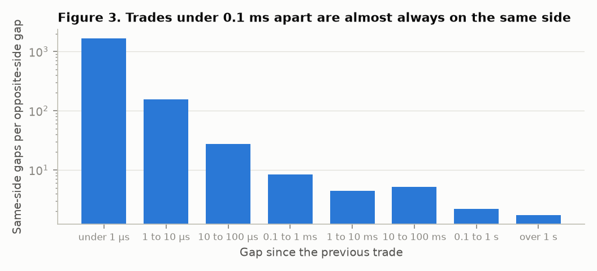
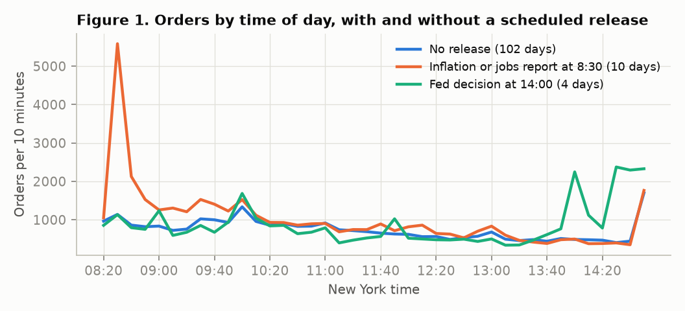
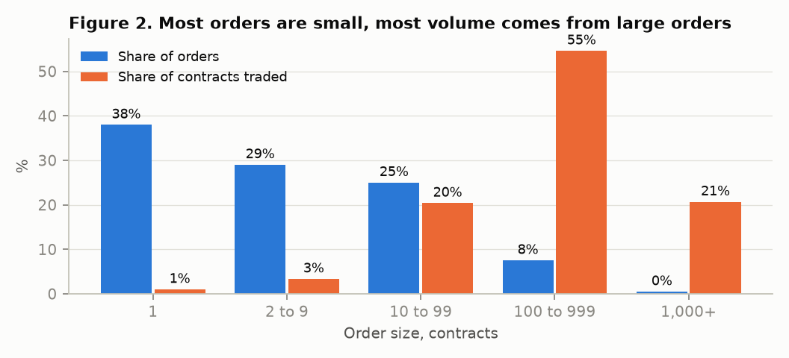
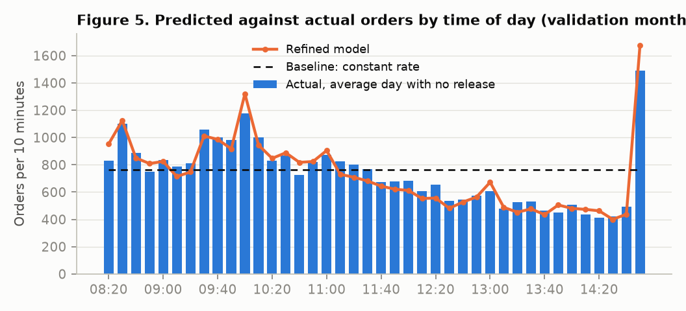
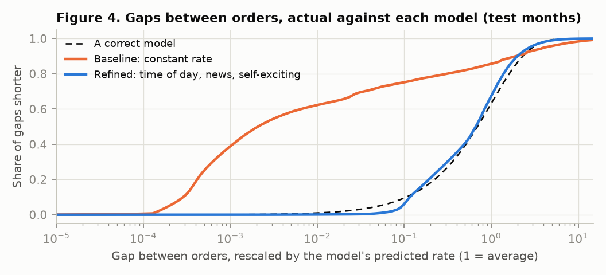

# Modelling Order Flow in Treasury Futures: When Orders Arrive, How Big They Are and Which Way They Go

FINS3666 Group Project, Appendix B: Client Order Flow Analysis. Idea-level draft in dot points, for the team to write up in its own words.

## 1. Introduction and Research Objective

- **Why order flow matters:** a market maker earns the spread only when someone trades against its quotes
  - Week 2: order flow, order imbalance and trade flow imbalance are the tools for adjusting quotes
  - Week 4, Ho and Stoll (1981): buy and sell orders arrive at random at fixed rates
  - Week 4, Glosten and Milgrom: the market maker loses to informed traders, whose orders run one way
- **Objective:** build and test a model of the orders hitting the 10-year US Treasury note future (ZN) on CME, then link it to price
- **The four Appendix B questions, answered up front:**
  - How often do orders arrive? About 76 a minute, in bursts
  - How big are they? Median 3 contracts, mean 38
  - Is flow balanced? Volume is balanced over a day, but an order repeats the previous side 80% of the time
  - Does it vary in the day? Yes, and it jumps fivefold after scheduled news
- **Why ZN:** the data shows the orders cleanly (Table 1)
- **First version on GLD:** it left us defending the data, so we moved to ZN
- **Assumption:** public data carries no client identity (Week 8), so we model all aggressive orders, meaning orders that cross the spread

**Table 1. Why ZN, against our first version on GLD**

| | ZN on CME | GLD on NYSE Arca |
|---|---|---|
| Share of the market seen | All of it, one exchange | One of 16 exchanges |
| Trades the exchange marks as buy or sell | 98.9% | 76% |
| Window for merging split orders | 0.1 ms, set by the data | 1 ms, chosen by us |
| Sample | 12 months, 238 days | 10 days |
| Known causes of bursts | Scheduled economic releases | None |

## 2. Data Description and Background Analysis

- **Source:** every ZN trade from 1 November 2025 to 30 October 2026, bought from Databento, each with the best bid and ask just before it
- **Timestamps:** the exchange's own, to the nanosecond
- **Session:** 08:20 to 15:00 New York time, 62% of the day's volume
- **Days left out, 22 in the year:**
  - US holidays and early closes
  - The two days before each quarterly contract roll, when trading moves to the next contract
- **Trades with no side:** 1.1%, dropped
- **News calendar:** 31 release times, each from the original government page. A government shutdown cancelled two reports and moved four

**Table 2. Dataset**

| | Fit | Validation | Test |
|---|---|---|---|
| Months | Nov 2025 to Apr 2026 | May to Aug 2026 | Sep to Oct 2026 |
| Days | 116 | 80 | 42 |
| Orders after merging | 3,552,370 | 2,414,025 | 1,715,538 |
| Days with an 8:30 inflation or jobs report | 10 | 8 | 4 |
| Days with a Fed decision at 14:00 | 4 | 2 | 2 |

- **The problem with raw trades:** 61% are for 1 contract, and many arrive 0.18 millionths of a second apart. That is one trader firing a stream of tiny orders
- **Where one decision ends (Figure 3):**
  - Under 0.1 ms apart, trades are on the same side 28 to 1,677 times more often than on opposite sides
  - Above 0.1 ms the ratio settles near 5
- **Merge rule:** same-side trades under 0.1 ms apart are one order. 6.8 million trades become 3.6 million orders

**Table 3. Background findings on the fit months and the choice each one sets**

| Finding | Evidence | Modelling choice |
|---|---|---|
| Orders cluster | Median gap 2 ms against a mean of 0.79 s | Self-exciting arrivals |
| Activity follows the clock and the news | Fivefold jump in the 10 minutes after an 8:30 release (Figure 1) | Rate by time of day and by kind of day |
| Sizes are lumpy with a long tail | 38% of orders are 1 contract. The largest 1% carry 31% of volume (Figure 2) | Extra weight at common sizes, separate tail |
| Volume is balanced, direction is not random | Daily buy share 0.46 to 0.54. Direction autocorrelation 0.59 at one order, 0.03 at 100 | Direction depends on the previous order |
| Persistence fades after big orders | Repeat rate 83% after a 1-contract order, 57% after 1,000+ | Direction depends on the previous size |
| The spread cannot move | One price step (1/64 of a point) 99.9% of the time | Read liquidity from quote sizes |

## 3. Model Development

- **Baseline:** the Week 4 Ho and Stoll picture. Two Poisson streams, a buy rate and a sell rate, which is one rate times a fixed chance of a buy
- **Refined:** each part fixes one background finding (Table 4)

**Table 4. Baseline and refined models**

| Part | Baseline | Refined |
|---|---|---|
| Arrivals | Rate λ, constant | λ(t) = c × s(t) × n(t) + Σ over earlier orders of [α₁β₁e^(-β₁Δ) + α₂β₂e^(-β₂Δ)] |
| Size | Lognormal, rounded to whole contracts | Fixed probabilities at 1, 2, 3, 4, 5, 10, 20, 25, 50 and 100. Lognormal elsewhere up to 400. A second lognormal above 400 |
| Direction | Buy with fixed chance p | P(buy) = logistic(a + b × previous side + d × previous side × log previous size + q × queue imbalance) |

- **Terms:**
  - s(t): the average rate in each 10-minute bucket
  - n(t): a scale on release days
  - Δ: the time since an earlier order
  - Queue imbalance: (bid size - ask size) / (bid size + ask size) just before the order, the Week 2 measure
- **Self-exciting arrivals (a Hawkes process, beyond the course):** each order raises the rate, and the rise fades at two speeds
- **Fitted values:**
  - One order triggers 0.53 further orders with a half-life of 1 ms
  - And 0.19 further orders with a half-life of 40 ms
  - So 72% of orders are triggered by an earlier order
- **Why this fits trading behaviour:**
  - Algorithms slice orders and react to each other (Week 1 execution algorithms, Week 8 latency)
  - The queue weight is large and positive: traders hit the side with little size left
- **Assumptions:**
  - Each day is one process
  - Size does not depend on arrival time
- **Model risk (Week 9):** the fit is not convex, so we start it from two points. Both reach the same answer

## 4. Testing and Validation

- **Pipeline (Week 7):**
  - Fit on the fit months
  - Refine on the fit and validation months
  - Score the test months once, after every model is frozen
- **Main score, named before the test:** joint log-likelihood per order, the sum across the three parts. Higher is better
- **Other scores:**
  - Fit error: the largest distance between the actual gaps between orders, rescaled by the model's predicted rate, and what a correct model would give (Kolmogorov-Smirnov distance). Zero is perfect
  - Count error: the miss in orders per 10 minutes, as a share of actual orders

**Table 5. Baseline scores, fit months**

| Part | Score | Baseline |
|---|---|---|
| All | Joint log-likelihood per order | -4.87 |
| Arrivals | Fit error | 0.633 |
| | Count error | 49% |
| Size | Share of orders of 100+ contracts, model against actual | 4.6% against 8.0% |
| Direction | Accuracy | 50% |

- **Reading:** the baseline scores barely move on unseen months (Table 8). It is stable, and wrong in the same way each time

## 5. Evaluation of Results

- **Where the baseline fails:**
  - Arrivals: a fit error of 0.63 means nearly two thirds of the gap distribution is misplaced (Figure 4). It expects orders spread evenly and gets clumps
  - Size: it predicts half as many large orders as arrive
  - Direction: it treats every order as a coin flip

- **What that means for a market maker:** 200 simulated days from each model against real days with no release (Week 7 Monte Carlo, Table 6)
  - Sizing risk from the baseline gives inventory swings a third smaller than reality
  - It plans for 8 orders in the worst second when 182 arrive

**Table 6. Simulated days against real days, validation months**

| Per day | Actual | Baseline | Refined |
|---|---|---|---|
| Net buying per minute, typical swing (contracts) | 1,418 | 940 | 1,420 |
| Net buying per minute, worst 1% of minutes | 5,176 | 3,276 | 4,736 |
| Orders in the busiest second | 182 | 8 | 97 |

- **What a quote keeps:** the Week 3 spread measures, applied to every order (Table 7)
  - A quote earns half a price step and gives most of it back within 10 seconds
  - Weighted by size it keeps nothing, because large orders take the whole half-spread back
  - The 10-second choice does not matter: per contract the amount given back is 0.50 to 0.53 of a price step at every horizon from 1 to 60 seconds
  - This is Glosten and Milgrom's breakeven market maker, seen in data

**Table 7. What a quote earns and gives back, unseen months**

| Measure (price steps) | Validation | Test |
|---|---|---|
| Earned by a quote when hit | 0.50 | 0.50 |
| Given back within 10 seconds, average order | 0.35 | 0.38 |
| Kept per contract, orders weighted by size | -0.01 | -0.01 |

- **Caveat:** these are market-wide figures for all resting quotes. Week 7 warns that market making cannot be backtested, so they are not one firm's profit

## 6. Model Refinement

- **One change per failure, mapped to Appendix B.7:**
  - Time of day and news: a rate for each 10 minutes, scaled on release days
  - Alternative approach: self-exciting arrivals
  - Parameters: common sizes and a separate tail
  - Buy and sell classification: the 0.1 ms merge window
  - Additional market variables: the previous order's size and the queue sizes

**Table 8. Each change and what it bought**

| Part | Model | Score | Fit | Validation | Test |
|---|---|---|---|---|---|
| Arrivals | Baseline: constant rate | Fit error, count error | 0.633, 49% | 0.648, 48% | 0.673, 45% |
| | + time of day | | 0.627, 39% | 0.642, 39% | 0.668, 41% |
| | + news | | 0.624, 38% | 0.638, 38% | 0.664, 39% |
| | + self-exciting (refined) | | 0.054, 37% | 0.052, 38% | 0.051, 39% |
| Size | Baseline: lognormal | Share of 100+ orders, model against actual | 4.6% against 8.0% | 4.6% against 7.5% | 4.6% against 8.1% |
| | + common sizes and tail (refined) | | 7.9% against 8.0% | 8.0% against 7.5% | 8.0% against 8.1% |
| Direction | Baseline: fixed chance | Accuracy | 50% | 49% | 50% |
| | + previous order and its size | | 80% | 81% | 82% |
| | + queue sizes (refined) | | 88% | 90% | 91% |
| All | Baseline | Joint log-likelihood per order | -4.87 | -4.80 | -4.59 |
| | Refined | | -1.05 | -0.89 | -0.67 |

- **Result:** every part improves, and the refined model scores as well on unseen months as on the fit months, so it is not overfitted
- **What each change bought:**
  - Time of day and news cut the count error from 48% to 38%. This is the gain a market maker planning the next 10 minutes can use
  - Self-exciting arrivals cut the fit error from 0.64 to 0.05 and leave the count error unchanged. Their memory is 40 ms, so they place orders inside a burst and say nothing about the next 10 minutes
  - Self-excitation is five sixths of the main-score gain (3.29 of 3.91 on validation)
- **Direction accuracy depends on the horizon (Table 9):**
  - Inside a burst the next order is near certain: 99% under 1 ms after the previous order
  - After a quiet second it is 66%, and queue sizes add 3 points
  - So 90% describes bursts. A market maker slower than a millisecond should plan on 66%

**Table 9. Direction accuracy by time since the previous order, validation months**

| Time since the previous order | Share of orders | Previous order and its size | With queue sizes |
|---|---|---|---|
| Under 1 ms | 42% | 88% | 99% |
| 1 to 100 ms | 32% | 83% | 93% |
| 0.1 to 1 s | 11% | 71% | 76% |
| Over 1 s | 16% | 64% | 66% |

- **Added after the test run, so shown for validation months only:** Table 9, the last column of Table 11 and the day-total figure in Section 7
- **Stability:** the refined fit error stays between 0.048 and 0.056 in every unseen month and on every kind of day
- **Simulation check before validation:** on the fit months it caught a size tail that was too heavy (Table 12) and direction that ignored size. Table 6 shows the result
- **Bursts are toxic:** Week 9 says more trades mean more contact with toxic flow. The arrival model tests it by sorting orders by how far the model's rate sits above its normal level (Table 10)

**Table 10. Price steps kept by a quote 10 seconds after it is hit**

| Order arrives in | Validation | Test |
|---|---|---|
| The calm half of orders | 0.25 | 0.20 |
| The busiest 10% (bursts) | 0.03 | 0.03 |
| Orders of 1 contract | 0.18 | 0.15 |
| Orders of 100+ contracts | 0.03 | 0.02 |

- **A quoting rule:** pull quotes in news windows and whenever the model's rate, as seen with a reaction delay, is above a threshold. Thresholds set on the fit months (Table 11)
  - What it tests: whether the model's burst signal avoids toxic fills, against always quoting on the same days
  - Reacting in 1 ms it avoids 0.022 of a price step per contract, 4 standard errors from zero
  - The effect shrinks with the delay, to 0.008 at 1 second (Week 8 latency)
  - It is not a profit. What a quote keeps stays near zero before fees, the rule quotes for 28% of orders, and a pulled quote rejoins the back of a queue of about 2,450 contracts

**Table 11. Price steps kept per contract quoted (standard error across days)**

| Rule | Validation | Test | Gain over always quote, validation |
|---|---|---|---|
| Always quote | -0.013 (0.006) | -0.007 (0.004) | |
| Pull quotes, reacting in 1 ms | +0.011 (0.007) | +0.007 (0.005) | +0.022 (0.005) |
| Reacting in 100 ms | +0.001 (0.006) | +0.002 (0.004) | +0.010 (0.005) |
| Reacting in 1 second | -0.002 (0.004) | +0.001 (0.004) | +0.008 (0.004) |

**Table 12. Variants tried and dropped (34 model variants fitted in total)**

| Variant | Result | Decision |
|---|---|---|
| Third decay speed | Fit error 0.048 against 0.053 in tuning | Dropped for simplicity, a judgment call |
| Memory of five orders | Accuracy unchanged at 79% | Dropped, per Week 9: throw away useless factors |
| Power-law size tail | Simulated swings 2.3 times actual | Replaced |
| Merge windows of 0.01 ms and 1 ms | Fit error 0.071 and 0.065 against 0.053 | Kept 0.1 ms |

## 7. Critical Reflection and Recommendations

**Table 13. Strengths and limitations**

| | Point | Evidence |
|---|---|---|
| Strength | Results hold on a test used once | Table 8: test matches validation |
| Strength | The model reproduces inventory swings | Table 6: 1,420 against 1,418 |
| Strength | Every variant is counted | Table 12 |
| Limitation | Activity over the next 10 minutes is a third off | Table 8: count error 38% |
| Limitation | The day's activity level is unexplained | Middle 90% of real days: 21,000 to 47,000 orders. Simulated: 28,000 to 30,000 |
| Limitation | The busiest second is understated | Table 6: 97 against 182 |
| Limitation | The quoting rule avoids losses but keeps nothing after fees | Table 11 |
| Limitation | Aggressive orders only | No client identity, no resting orders |
| Limitation | The best model still fails a strict test | Fit error 0.05 against a 5% threshold near 0.001 |

- **The limit that matters most: activity over the next 10 minutes**
  - The refined count error is 38% on the validation months
  - Knowing each day's total in advance would only cut it to 33%, so most of the miss sits within the day
  - Activity clusters over minutes: how far a 10-minute bucket runs above the model has a 0.47 correlation with the next bucket. The model's memory ends at 40 ms
  - The day's level matters when it shifts. September and October ran at about 40,000 orders a day against 30,000 in the fit months, and there the model understates the typical inventory swing by 13% (1,420 against 1,632)
- **The spread cannot widen:** ZN sits at one price step, so the Week 4 prediction that spreads widen with risk shows up in what a quote keeps (Table 10), not in the spread
- **Fees:**
  - The 0.007 to 0.011 of a price step the rule keeps is worth about US$0.11 to US$0.17 a contract
  - A retail broker lists the exchange fee at US$0.80, so only a low-fee member firm could keep any of it
  - Week 9: market makers get crowded out when liquidity is high. This is what that looks like
**Recommendations for real-world use**

1. **Update the rate through the day**
   - Why: the count error is the largest miss, and most of it sits within the day
   - How: scale the rate by how the last 10 minutes ran against the model and by a trailing average of daily activity. Judge a slow decay speed on count error, which fit error cannot see
2. **Add resting orders from full order book data, then test an inventory skew rule**
   - Why: the Week 2 notes point to Avellaneda and Stoikov, where a market maker shifts its quotes to shed inventory
   - Blocker today: a test needs to know which resting quotes fill, which trade data cannot show
3. **Run the model live as a monitor**
   - Why: Week 9 lists model health among the things to watch
   - How: compare the predicted rate with the actual rate each second, pull quotes when a burst starts, flag days when the level drifts

## Appendix A: AI Use

Draft for the team to complete.

- **What we used it for:** an AI coding assistant (Claude) explored the data, tested and ruled out candidate strategies, wrote the analysis code, checked the idea against the lecture slides and drafted this report
- **Justification:** the analysis covers 22 million trades and 34 model variants. The assistant let a small team run it reproducibly within the time allowed
- **What the team did:** chose the topic and the asset, decided each modelling question the assistant raised, reviewed the method and results, and is responsible for the final text
- **Code:** all submitted with the report

## Appendix B: Team Roles

| Member | Role | Contribution |
|---|---|---|
| | Trading | |
| | Quantitative analysis | |
| | Technology | |
| | Sales (report) | |
| | Risk | |
